 

---

### 👋 About me

I'm a **Flutter developer and UI/UX designer** from Islamabad, studying **BS Computer Science at Bahria University**. I work across the whole product: research and wireframes in Figma, then building the app in Flutter with Firebase behind it. These days I'm focused on bringing **AI into mobile apps**.

- 📱 Built cross-platform Flutter apps at **KodexByte** (intern, 2026) and **SPS – Software Productivity Strategists** (2025)
- 🎨 Freelance mobile UI/UX designer since 2023 for fintech, social and e-commerce clients
- ✒️ Delivered **300+ logo and brand identity projects** as Senior Logo Designer at Authornate
- 🌍 Open to **startup roles** where product design and mobile engineering meet

### 🏆 Honors & certifications

| Honor | Details |
| 🎓 **Millennium Campus Network (MCN) Fellow — Class of 2026** | Selected for the global fellowship; presented **NeuralSafe** to the cohort |
| 📜 **Introduction to AI** | Hewlett Packard |

### 🚀 Selected projects

| Project | What it is | Built with |
|---|---|---|
| **NeuralSafe**  Final Year Project · MCN Fellowship | AI-powered domestic violence detection app with a "Triple-Guard" design: CNN voice-distress detection, XLM-RoBERTa multilingual text analysis and a behavioural monitor, plus a stealth calculator disguise mode. | Flutter · CNN · XLM-RoBERTa · Random Forest / SVM |
| [**Etheric**](https://github.com/fasihabbasi7/Etheric-Modern-Productivity-Task-Management-App-Flutter) | A clean, minimal productivity and task management app with calendar planning and a premium UI designed in Figma. | Flutter · Dart · Figma |
| [**SnapFilters**](https://github.com/fasihabbasi7/SnapFilters) | Flutter camera app that applies live meme-style and cinematic filters to the camera preview and saves results to the gallery. | Flutter · Dart · Camera · Image processing |
| [**VERIFAI**](https://github.com/fasihabbasi7/VERIFAI--Fake-News-Detection) | Machine learning system that classifies news articles as real or fake using TF-IDF features, served through an API with a web front end. | Python · scikit-learn · FastAPI · NLTK |
| [**Morse Code Converter**](https://github.com/fasihabbasi7/Morse-Code-Converter) | Console app that converts text to Morse code and back, with sound output. | C++ · Data structures |

🎨 More app UI and branding work is on <a href="https://www.behance.net/fasihabbasi1">Behance</a>.

### 🛠️ Tech stack

**Mobile development**
 

 Firebase Auth · Firestore · Realtime Database · Cloud Storage · REST APIs · State management

**UI/UX & design**
 

 Figma · Adobe XD · Sketch · Illustrator · Wireframing · Prototyping · Design systems · Component libraries

**AI/ML, languages & tools**
 

### 📊 GitHub activity

### 🌐 Languages

English (fluent) · Urdu (native)

 

